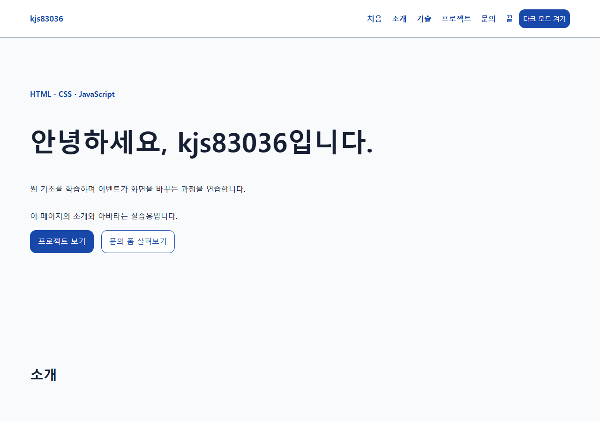
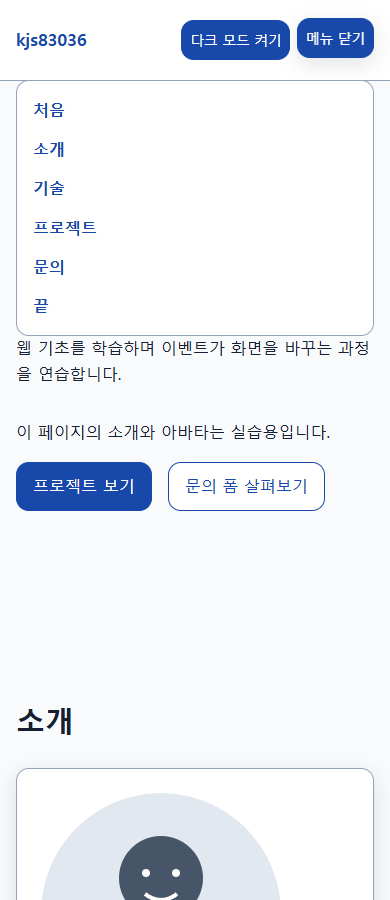
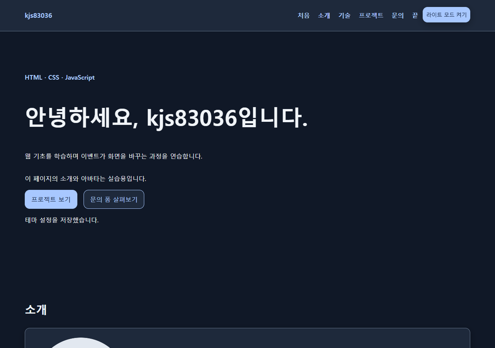

# 웹 기초 포트폴리오 실습

kjs83036의 HTML/CSS/JavaScript 학습용 포트폴리오입니다. 소개와 직접 그린 아바타는 실습용이며 실제 학력·경력·성과를 나타내지 않습니다.

## 기술과 실행

외부 라이브러리 없이 HTML/CSS/JavaScript를 사용합니다. 환경은 Windows PowerShell7, VS Code1.143.1, Live Server5.7.10, Chrome입니다.

1. VS Code에서 프로젝트 폴더를 엽니다.
2. index.html에서 Open with Live Server를 실행합니다.
3. http://127.0.0.1:5500/index.html 을 엽니다.
4. GitHub 프로젝트 불러오기를 누르면 kjs83036 공개저장소를 최신수정순 최대100개(fork포함) 조회합니다. 새로고침만으로는 요청하지 않습니다.

## 구현 흐름

- 테마버튼→상태→data-theme→localStorage portfolio-theme 저장.
- 조회/재시도→로딩/성공/빈/오류→카드·안내·버튼.
- 폼 input/submit→필수값/이메일유효성→근처오류/실습용성공.
- 메뉴토글·부드러운앵커이동·탑버튼·네비배경·Observer등장효과.

모바일퍼스트, breakpoint768/1024px입니다. 네비배경은scrollY>=60px, 탑버튼은scrollY>=300px, Observer threshold0.2입니다. 동작줄이기 설정에서는 전환을 생략합니다. 실제메일은 전송하지 않습니다. 언어필터·타이핑·실제전송·시스템테마는 선택보너스로 제외했습니다.

API는 https://api.github.com/users/kjs83036/repos 입니다. 비인증 기본제한60회/시간이므로 반복호출을 피합니다. HTTP오류·네트워크예외에 오류안내와 재시도버튼을 표시합니다. 외부문자열은 HTML에 넣기전 이스케이프합니다.

## 파일

index.html은 시맨틱구조, css/style.css는 반응형/테마, js/main.js는 DOM이벤트, js/projects.js는 API/상태/카드, images/profile.svg는 실습용이미지입니다.

## 검증

최초 구현자의 미실행 기록은 execution.md에 보존했습니다. 아래 표는 2026-10-26의 부모 후속 관측과 2026-10-27의 GPT-6 Luna / Max 촬영 결과를 반영합니다. 문서에 적힌 절차만으로 수행한 순수 재현과 후속 보완 증거는 구분합니다.

| 범위 | 상태 | 실제 근거 |
|---|---|---|
| 로컬 제품 UI | PASS | 부모가 실제 Chrome에서 테마·메뉴·앵커·폼·반응형 등 24개 관측 그룹을 확인 |
| 모의 API/재시도 | PASS | 부모가 개발용 검증 화면의 최종 12행 PASS/0 FAIL을 확인; 실제 서비스 호출과 구분 |
| 실제 GitHub API | PASS | 부모의 실제 버튼 조회 1회에서 당시 공개 저장소 27개 표시 |
| 실제 PNG 3장 저장/내용 확인 | PASS | GPT-6 Luna / Max가 Playwright의 headless Google Chrome 156.0.8078.47에서 저장하고 PNG 형식·크기·화면을 확인 |
| GitHub Pages | NOT_RUN | 공개 저장소·Pages를 만들지 않음 |
| 실제 제출 | NOT_RUN | 제출처·행위·접수 확인 없음 |

별도 후속 관측에서 VS Code Live Server 5500의 실행과 파일 변경 자동 반영·원본 복원을 확인했습니다. PNG 촬영은 로컬 Python HTTP 서버를 사용했으며, 새 브라우저 context의 Projects 초기 상태를 촬영했습니다. 기존 사용자 Chrome 프로필이나 인증 세션은 사용하지 않았습니다.

checks/·.vscode/·execution.md는 개발용으로 공개업로드에서 제외합니다. 모의통과는 실제서비스·배포완료의 증거가 아닙니다.

## URL

- 저장소: 아직 생성하지 않음 (NOT_RUN)
- 배포: 미배포 (NOT_RUN)

## 스크린샷

촬영 URL은 http://127.0.0.1:5500/index.html 입니다. desktop.png와 dark.png는 1280×900, mobile.png는 390×900입니다. 각각 라이트, 모바일 메뉴 펼침, 다크 상태이며 Projects는 모두 초기 상태입니다. PNG는 Playwright로 직접 저장했습니다.

